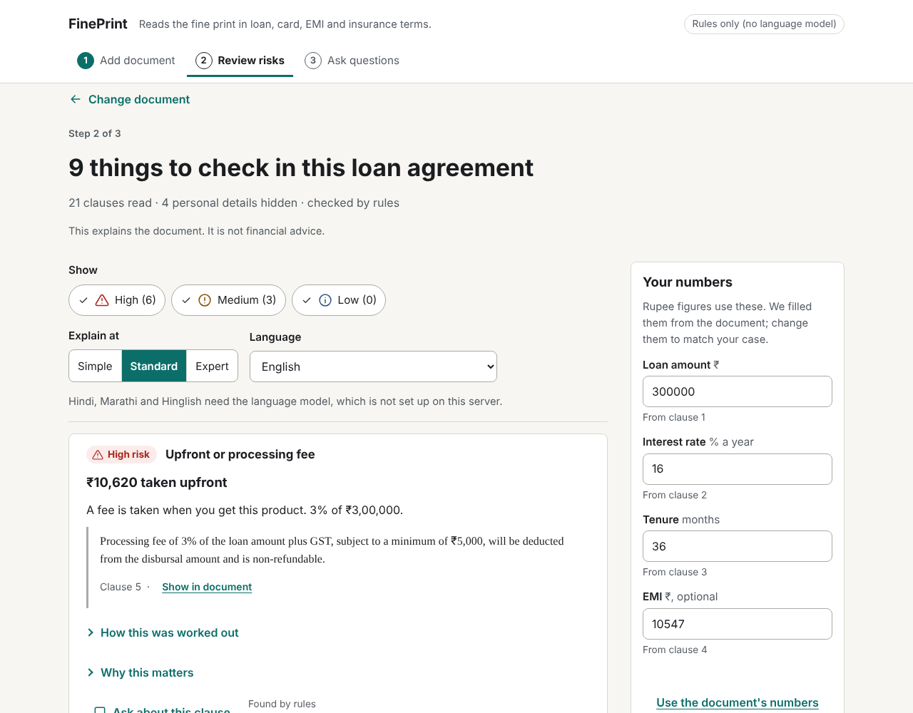

# FinePrint

FinePrint reads an Indian loan, credit card, pay-later or insurance document and shows, in plain words and in rupees, which clauses can cost you money.



- **Flags 14 kinds of risky clause** (prepayment penalty, floating rate, late and bounce charges, "0% EMI" traps, bundled insurance, set-off, data sharing, waiting periods and more), each with a severity shown as an icon, a word and a colour.
- **Turns each risk into rupees** with a deterministic calculator: the language model never does arithmetic.
- **Quotes every flag from the document.** Model suggestions whose quote is not in the document are dropped.
- **Explains at three reading levels** (Simple, Standard, Expert) and **in four languages** (English, Hindi, Marathi, Hinglish).
- **Answers questions in code-mixed Hinglish**, such as "mera EMI bounce hua toh kitna lagega?", citing the clause.
- **Hides personal data** (names, PAN, Aadhaar, card, account and phone numbers, emails) before anything is analysed.
- **Works without an API key** in rules-only mode, so a demo never fails.

## Run it

```bash
python -m venv .venv && source .venv/bin/activate      # Windows: .venv\Scripts\activate
pip install -r requirements-dev.txt
cp .env.example .env                                     # optional: add an LLM key
PYTHONPATH=src uvicorn fineprint.api:app --reload        # Windows PowerShell: $env:PYTHONPATH="src"
```

Open http://localhost:8000.

With Docker: `docker build -t fineprint . && docker run -p 8000:8000 --env-file .env fineprint`.

## Turn on the language model (optional)

Set three variables in `.env` or in your host's settings. Any OpenAI-compatible endpoint works:

| Provider | `LLM_BASE_URL` | `LLM_MODEL` |
| --- | --- | --- |
| Groq | `https://api.groq.com/openai/v1` | a current Llama or similar model name from Groq's docs |
| Google Gemini | `https://generativelanguage.googleapis.com/v1beta/openai/` | a current Gemini Flash model name |
| OpenAI | leave empty | a current small GPT model |

Add the key as `LLM_API_KEY`. Without it, FinePrint runs rules only and explains in English.

## Test and evaluate

```bash
python -m pytest -q                      # 52 tests, no network or model needed
python eval/run_eval.py                  # writes eval/results.md (rules; plus llm and hybrid if a key is set)
python eval/kappa.py sheet data/samples/s01_personal_loan.txt > a.csv   # make an annotation sheet
python eval/kappa.py score a.csv b.csv   # Cohen's kappa between two annotators
```

Current rules-only results on the 12 sample documents (64 gold labels): F1 1.00 on the dev split used while writing the rules, **0.84 on the held-out test split**. See `eval/results.md`. The samples were written by the same team that wrote the rules, so add real documents (`data/real/`, kept out of git) and label them independently for a fair score.

## Deploy

- **Render:** New > Blueprint > pick this repo. `render.yaml` builds the Dockerfile; add `LLM_*` values as secrets.
- **Any Docker host** (Railway, Fly.io, Hugging Face Spaces, a VM): build the Dockerfile; the app listens on `$PORT` (default 8000).

CI (`.github/workflows/ci.yml`) runs the tests and the evaluation and builds and smoke-tests the image on every push.

## Layout

```
src/fineprint/
  ingest/    loader.py (PDF/text), pii.py (masking), segmenter.py (clauses with offsets)
  extract/   money.py (₹, %, durations), context.py (amount, rate, tenure, document type)
  risk/      taxonomy.py (14 categories), rules.py, llm_classifier.py, verify.py (quote check), pipeline.py (hybrid)
  calc/      impact.py (rupee calculator)
  kb/        reference.json (RBI/IRDAI notes), bm25.py, retriever.py
  explain/   explainer.py (levels, languages, number guard), readability.py
  qa/        lang.py (Hinglish detection), guardrails.py, chat.py (grounded Q&A)
  llm/       client.py (OpenAI-compatible wrapper)
  service.py, api.py, config.py, schemas.py
web/         index.html, styles.css, app.js (no build step)
data/        samples/ (12 documents), eval/gold.json
eval/        run_eval.py, kappa.py, results.md
tests/       52 tests
```

FinePrint explains documents. It is not financial advice.
